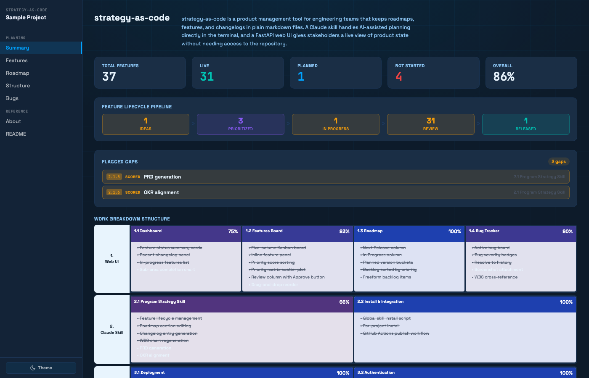
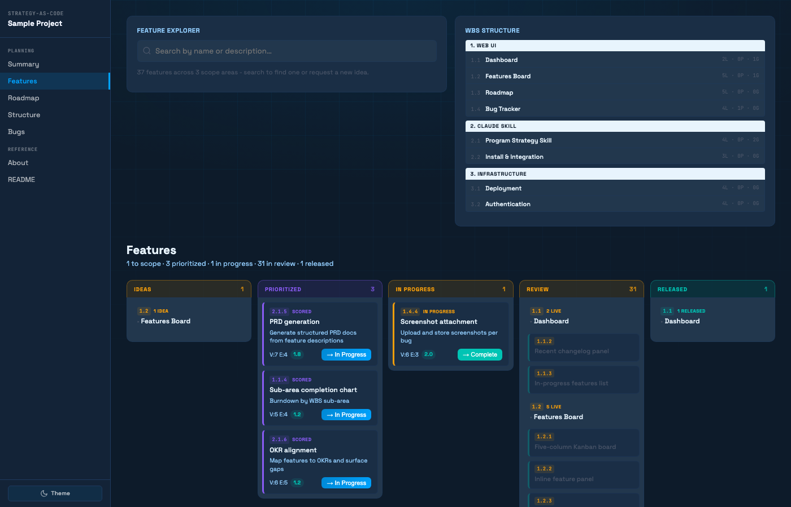
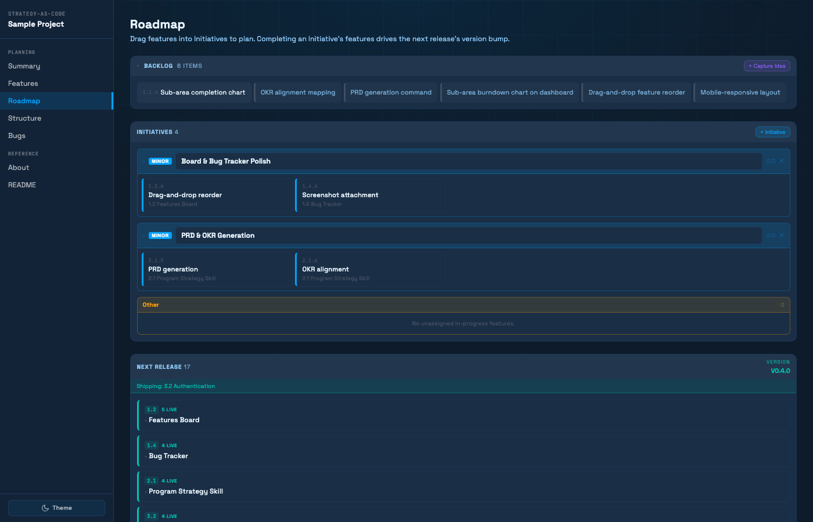
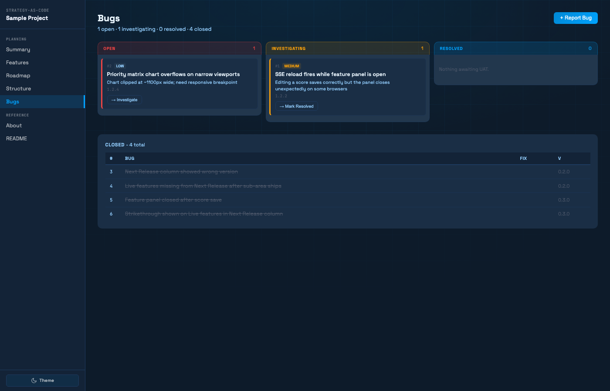

# strategy-as-code

Core information for communication, design, and project planning.

Each interface audience is supported by a respective markdown file.

Other workflows and reports for stakeholders, engineers, and end-users derive from these sources of truth.

Interface with: 

| File         | Purpose                                   | Audience                      | Interface                        |
| ------       | ---------                                 | ----------                    | -----------                      |
| `PRODUCT.MD` | Overview, WBS structure, feature registry | Stakeholders                  | Web UI                           |
| `README.MD`  | Operational and dev documentation         | Operational and dev engineers | Claude skill & Markdown          |
| `ABOUT.MD`   | Changelog and roadmap                     | Users                         | Markdown for app & documentation |
| `BUGS.MD`    | Bug tracking and triage                   | All                           | Markdown & Web UI                |

## Screenshots

**Summary** - feature counts, lifecycle pipeline, flagged gaps, and WBS completion



**Features** - five-column Kanban with WBS structure sidebar



**Roadmap** - Backlog, named Major/Minor Initiatives, and Next Release



**Bugs** - active bug board with severity badges and resolved history



## Install the Claude skill

The `program-strategy` skill teaches Claude Code to manage your product documentation using the four-file format above.

**Global install** (available in all projects):

```bash
git clone https://github.com/dactylroot/strategy-as-code
cd strategy-as-code
./scripts/install-skill.sh
```

**Per-project install** (available only in one project):

```bash
./scripts/install-skill.sh /path/to/your/project
```

The script symlinks `.claude/skills/program-strategy/` into the target skill directory. Once installed, open any Claude Code session in the target project and invoke it with:

```
/program-strategy
```

The skill manages the four markdown files directly - reading and editing them in whichever directory the Claude Code session is open in.

**OpenCode:** it reads `.claude/skills/` and `~/.claude/skills/` too, so the install above works unchanged. To install under OpenCode's own directories instead, pass `--opencode` (global: `~/.config/opencode/skills/`, per-project: `.opencode/skills/`):

```bash
./scripts/install-skill.sh --opencode [/path/to/your/project]
```

To launch the web UI from within a skill session, tell Claude to run the UI:

```
run the UI
```

Claude will start the server pointed at the current project directory and open `http://localhost:8765` in your browser. The UI reads files on each page load, so edits the skill makes are visible immediately without restarting.

## Run the UI

### Local (Python)

Requires Python 3.12 and [pyenv](https://github.com/pyenv/pyenv).

```bash
pip install -r requirements.txt
PROJECT_DIR=/path/to/your/project ./run.sh
```

Runs on `http://localhost:8765`. Set `APP_TITLE` to override the page title:

```bash
APP_TITLE="My Product" PROJECT_DIR=/path/to/your/project ./run.sh
```

### Docker

Copy `.env.example` to `.env` and set your project path:

```bash
cp .env.example .env
# Edit .env: PROJECT_SOURCE_PATH=/path/to/your/project
```

Then start the container:

```bash
docker-compose up
```

Runs on `http://localhost:8765`.

### Pre-built image (ghcr.io)

```bash
docker run -p 8765:8000 \
  -v /path/to/your/project:/project \
  ghcr.io/dactylroot/strategy-as-code:latest
```

Supports `linux/amd64` and `linux/arm64`.

#### Environment variables

| Variable | Default | Description |
|----------|---------|-------------|
| `PROJECT_DIR` | `/project` | Path to project inside the container |
| `APP_TITLE` | Derived from `PRODUCT.MD` | UI page title |
| `PORT` | `8000` | Port to bind |
| `GIT_REPO_URL` | | Git repo to clone on first run |
| `GIT_TOKEN` | | HTTPS token for push/sync |
| `GIT_USER_NAME` | | Git commit author name |
| `GIT_USER_EMAIL` | | Git commit author email |
| `AUTH_CONFIG` | `~/.config/strategy-as-code/auth.yml` | Path to local-login config (`enabled`, `username`, `password`, `secret_key`) |
| `SERVER_CONFIG` | `~/.config/strategy-as-code/server.yml` | Path to deployment config (`project_dir`, `lock_project`, `app_title`) |
| `BASE_PATH` | (empty) | URL prefix to serve under, e.g. `/strategy` - see [Embedded](#embedded) below |
| `AUTH_INTROSPECT_URL` | (empty) | Host session-introspection endpoint - see [Embedded](#embedded) below |
| `HUB_AUTH_URL` | (empty) | RevOps hub `/internal/auth?app=strategy`. Enables hub identity: the visitor's cookie is forwarded, the hub's `X-User-Email` and `X-App-Role` answer is the only identity accepted (`viewer` reads, `editor` and `admin` write, `contributor` and `reporter` are limited roles, see Roles in hub mode; the request names its project with `&project=<key>` and the manifest key must equal the hub's app key), and `X-Host-User` is ignored |
| `PROGRAM_POLL_SECONDS` | `45` | Background refresh of every member project's clone; `0` turns it off |
| `PROGRAM_NESTED_DEPTH` | `3` | A manifest row with `Kind` = `program` is a nested program: its own `PROGRAM.MD` (in its `Planning Dir`) is read and its projects are listed as `<row key>.<project key>`, with their `Depends On` prefixed the same way. This is how many levels to follow; `0` turns nesting off. A program that would contain itself (same repository and folder further up) is always refused. Re-read on every poll |
| `PROGRAM_SWEEP_SECONDS` | `86400` | How often every project's inbox is swept: items untriaged for 60 days move to `.planning/inbox/archive/`, one commit per project that had any; `0` turns it off |
| `PLANNING_PR` | `true` | After a push to a branch-mode project's planning branch, open (or refresh the description of) one pull request to the default branch. Needs `GIT_TOKEN` and a github.com repository; `false` turns it off. `strategy pr -p <key>` does the same on demand |
| `WEBHOOK_SECRET` | (empty) | Enables `POST <base>/hooks/refresh` for signed GitHub push events |
| `HOST_LOGIN_URL` | (empty) | Host's login page, used as the redirect target in embedded mode |
| `HOST_HOME_URL` | (empty) | Host's home page; the Program overview title links to it, and the no-access page when no project applies |
| `EMBED_CHROME` | `false` | When `true`, hides this app's own sidebar/nav - use when the host page already provides navigation, e.g. inside an iframe |

### Roles in hub mode

| Role | Who the hub gives it to | What it reaches |
|---|---|---|
| `viewer` | (reserved) | Every page, read only |
| `editor`, `admin` | Hub administrators | Everything, in every project |
| `contributor` | An active Power User of the project's app | In its own project only: the Features and Bugs pages (a read-only view with a submit form, not the editing pages), `POST /api/inbox` for bugs and features, `GET /api/inbox/mine`, `PATCH` and `DELETE` on its own waiting items, screenshots of its own items, and `GET /api/about/html` |
| `reporter` | Anyone else with a grant in the project's app | In its own project only: `POST /api/inbox` for bugs, `GET /api/inbox/mine`, screenshots of its own items, and `GET /api/about/html`. No page opens |

A limited role is a table of method and path patterns (`CONTRIBUTOR_ROUTES` and `REPORTER_ROUTES` in `app/hub_identity.py`): a route not listed there is closed to it, so a new endpoint stays closed until someone lists it. Ownership of an inbox item is checked by the endpoint, by the submitter's email.

What a contributor sees is filtered on the server (`app/contributor.py`): every feature, with its notes; a bug only when it has a WBS reference or the contributor submitted it, with its notes only when it is theirs; a closed bug only when it is theirs (the Closed table has no WBS column).

### Writes must come from this site's own pages

In hub mode the API router refuses a write (any method but GET, HEAD or OPTIONS) that the browser says came from elsewhere (`refuse_cross_site_writes` in `app/hub_identity.py`, a dependency of the API router, so every present and future `/api` write is covered). `Sec-Fetch-Site` of `same-origin` or `none` is accepted; `cross-site` and `same-site` get a 403, which is what stops a page on another host under the same site from using a visitor's hub cookie (`SameSite=Lax` alone does not). A browser that sends no `Sec-Fetch-Site` is judged by `Origin`, which must be the server's own origin or that of `HOST_HOME_URL` (the Renewals proxy hides the public host from this server). A request with neither header is not a browser and is let through. Standalone and embedded modes are unchanged.

### Submissions and their outcomes

A submission is one file under `.planning/inbox/`, committed as the submitter. Its id ends with a tag of the submitter's email (`submitter_tag`), so an app can find one person's items by file name. Until it is triaged only its submitter changes it. Promoting, declining or marking a duplicate moves it, without its description or screenshot, to `.planning/triaged/<id>.md` with the outcome (`promoted` with what it became, `declined` with the reason, `duplicate` of what), kept for a year. `GET /api/inbox/mine` returns a person's waiting and triaged items, each promoted one with the current state of the row that carries its `(inbox <id>)` marker.

`GET /api/about/html` is the project's ABOUT.MD rendered, with its newest released version; the apps show it on their About page.

### Deployment modes

The app runs in one of three modes, chosen by which of the variables above are set.

#### Standalone

The default. The app owns its own domain/port and handles its own login against `auth.yml`.

```bash
PROJECT_DIR=/path/to/your/project ./run.sh
```

#### Locked

Pins the UI to a single project directory and hides the "Switch Project" screen. Combine with either standalone or embedded mode. Set `lock_project: true` in `server.yml` (path from `SERVER_CONFIG`):

```yaml
project_dir: /path/to/your/project
lock_project: true
```

#### Embedded

Serves the app inline under a host project's own domain at a path prefix, trusting the host's session instead of showing a second login screen.

```bash
BASE_PATH=/strategy \
AUTH_INTROSPECT_URL=http://host-app:8080/internal/whoami \
HOST_LOGIN_URL=/login \
EMBED_CHROME=true \
PROJECT_DIR=/path/to/your/project ./run.sh
```

- `BASE_PATH` prefixes every route, redirect, and link so the app resolves correctly behind a reverse proxy forwarding `host.com/strategy/*` to it.
- `AUTH_INTROSPECT_URL` points at an endpoint on the host that validates its own session cookie, however the host authenticates its users (Okta or otherwise), and returns `200` or `401`. Setting this replaces local login entirely, and access fails closed if the host is unreachable.
- `HOST_LOGIN_URL` is where unauthenticated visitors get redirected, so there's exactly one login screen for the combined experience.
- `EMBED_CHROME=true` hides this app's own sidebar/nav, e.g. when it's shown inside an iframe on a host page that already has its own navigation. The host is then responsible for letting users get to Dashboard/Features/Roadmap/Structure/Bugs (e.g. by pointing the iframe's `src` at `{BASE_PATH}/dashboard`, `{BASE_PATH}/features`, etc).

To attribute bugs/features created through the embed to the actual host user (not a shared service account), have the host's reverse proxy forward an `X-Host-User` header (any stable identifier - username, email) on every request it proxies through. `POST /api/bugs` and `POST /api/features` use it as the `owner` when the request body doesn't set one explicitly; owner and UAT-confirmed can be reassigned later from either app's UI regardless of how they were first set.
- `EMBED_CHROME=true` hides this app's own sidebar/nav, e.g. when it's shown inside an iframe on a host page that already has its own navigation. The host is then responsible for letting users get to Dashboard/Features/Roadmap/Structure/Bugs (e.g. by pointing the iframe's `src` at `{BASE_PATH}/dashboard`, `{BASE_PATH}/features`, etc).
