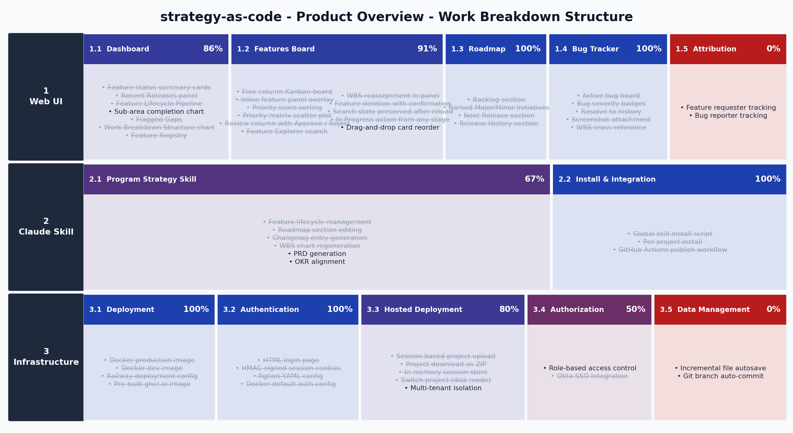

# strategy-as-code - Product Overview

## Summary
strategy-as-code is a product management tool for engineering teams that keeps roadmaps, features, and changelogs in plain markdown files. A Claude skill handles AI-assisted planning directly in the terminal, and a FastAPI web UI gives stakeholders a live view of product state without needing access to the repository.

## Users

### Product Manager
Maintains the feature backlog, sets priorities, and tracks releases. Works through the web UI to score features, move items through the lifecycle, and communicate roadmap state to leadership.

### Engineering Lead
Reviews incoming feature requests, marks features in-progress, logs bugs, and cuts releases. Uses the Claude skill in the terminal to draft changelog entries and update roadmap sections without leaving the editor.

### Stakeholder
Reads the roadmap and changelog to understand what is shipping and when. Accesses the web UI directly; never touches markdown files.

## Product Scope

### Core Functionality
- ~~Four-file markdown schema (PRODUCT, ABOUT, README, BUGS)~~ 🎆
- ~~Web UI with live-reload on file changes~~ 🎆
- ~~Feature lifecycle (Idea → [Scored] → In-Progress → Live → Released, with Scored derived from Value alone rather than stored)~~ 🎆
- ~~Value / Effort scoring with priority score calculation~~ 🎆
- ~~Feature panel with inline editing~~ 🎆
- ~~Release workflow with changelog automation~~ 🎆
- ~~Feature Registry and Flagged Gaps consolidated onto the Summary dashboard~~ 🎆
- ~~Shared themed confirm/alert dialogs~~ 🎆
- WBS chart generation (PNG + interactive HTML)

### Planning & Roadmap
- ~~Roadmap page with Backlog, Initiatives, and Next Release sections~~ 🎆
- ~~Named, renamable Major/Minor Initiatives replacing pre-planned version buckets~~ 🎆
- ~~Semantic versioning driven by completed Major/Minor Initiatives~~ 🎆
- ~~Review column for Live features awaiting UAT sign-off~~ 🎆

### Collaboration
- ~~Claude skill for AI-assisted product planning~~ 🎆
- ~~Single-user authentication (figtion-based YAML config)~~ 🎆
- ~~Docker image with ghcr.io publish workflow~~ 🎆
- ~~Session-based project upload for hosted deployments~~ 🎆

### Bug Tracking
- ~~Bug lifecycle (Open → Investigating → Resolved → Closed)~~ 🎆
- ~~Severity tiers (Critical / High / Medium / Low)~~ 🎆
- ~~Bug screenshot attachments~~ 🎆
- ~~WBS cross-reference for bugs~~ 🎆

## WBS Chart

[Interactive version](docs/wbs.html)

## Core Workflows

### Product Manager Workflow
1. Open the web UI and navigate to Features
2. Review the Ideas column for newly captured requests
3. Scope features by adding descriptions - they read as Scoped automatically once notes are saved
4. Score features with Value and Effort to compute priority
5. Navigate to Roadmap to sequence upcoming releases
6. Cut a release via the UI when In Progress items are Live

### Engineering Lead Workflow
1. Open a Claude Code session in the project repo
2. Invoke /program-strategy and describe the work
3. Claude updates PRODUCT.MD, ABOUT.MD, and BUGS.MD
4. Push changes - the live UI reflects updates immediately

## Features

### 1. Web UI

#### 1.1 Dashboard

| WBS | Feature | Status | Value | Effort | Notes |
| --- | ------- | ------ | ----- | ------ | ----- |
| 1.1.1 | Feature status summary cards | Live | 8 | 2 | Total / Live / Planned / Not Started counts with overall completion % |
| 1.1.2 | Recent Releases panel | Live | 6 | 1 | Last 3 versions' changelog entries grouped by WBS sub-area, with an In Progress badge on the unreleased version |
| 1.1.3 | Feature Lifecycle Pipeline | Live | 7 | 2 | Ideas / Prioritized / In Progress / Review / Released counts as a five-stage pipeline; supersedes the old in-progress features list |
| 1.1.4 | Sub-area completion chart | Idea | 5 | 4 | Burndown by WBS sub-area |
| 1.1.5 | Flagged Gaps | Live | 7 | 2 | List of Flag-tagged features shown above the WBS chart; replaces the old free-text Known Gaps card |
| 1.1.6 | Work Breakdown Structure chart | Live | 8 | 4 | Swimlane view of WBS completion embedded in Summary; features are clickable to open the feature panel |
| 1.1.7 | Feature Registry | Live | 7 | 3 | WBS-area feature table with inline status/value/effort editing and an Add Feature form; consolidated here from the removed Registry page (`/registry` and `/product` now redirect to `/dashboard`) |

#### 1.2 Features Board

| WBS | Feature | Status | Value | Effort | Notes |
| --- | ------- | ------ | ----- | ------ | ----- |
| 1.2.1 | Five-column Kanban board | Live | 9 | 4 | Ideas, Prioritized, In Progress, Review, Released |
| 1.2.2 | Inline feature panel overlay | Live | 9 | 5 | Edit name, status, score, notes; WBS reassignment; gap flagging |
| 1.2.3 | Priority score sorting | Live | 8 | 2 | Prioritized column sorted by Value/Effort ratio |
| 1.2.4 | Priority matrix scatter plot | Live | 6 | 3 | Visual Value vs Effort quadrant for scored features |
| 1.2.5 | Review column with Approve / Reject | Live | 8 | 3 | Advance or reject Live features after UAT |
| 1.2.6 | Feature Explorer search | Live | 8 | 3 | Keyword search across name and notes with ranked results |
| 1.2.7 | WBS reassignment in panel | Live | 7 | 3 | Drag token or click sub-area to move feature across WBS |
| 1.2.8 | Feature deletion with confirmation | Live | 6 | 2 | Requires typing the feature name to confirm; removes from PRODUCT.MD |
| 1.2.9 | Search state preserved after reload | Live | 5 | 1 | sessionStorage restores active query after panel-triggered page reload |
| 1.2.10 | In Progress action from any stage | Live | 7 | 2 | → In Progress button visible on Scoped and Scored cards and in panel |
| 1.2.11 | Drag-and-drop card reorder | Idea | 5 | 6 | SortableJS within Kanban column |

#### 1.3 Roadmap

| WBS | Feature | Status | Value | Effort | Notes |
| --- | ------- | ------ | ----- | ------ | ----- |
| 1.3.1 | Backlog section | Live | 7 | 2 | Collapsible; flat list of scored ideas ordered by descending priority score plus freeform items from ABOUT.MD's Backlog list |
| 1.3.2 | Named Major/Minor Initiatives | Live | 9 | 5 | Features grouped into user-named, renamable Initiatives with a clickable Major/Minor toggle; alphabetical order with a bottom-pinned "Other" bucket for unassigned in-progress features; completing every feature in an Initiative drives the next release's semver bump |
| 1.3.3 | Next Release section | Live | 8 | 2 | Read-only; shows the pending version with Live features grouped by sub-area |
| 1.3.4 | Release History section | Live | 6 | 2 | Read-only list of shipped versions and their changelog entries, below Next Release |

#### 1.4 Bug Tracker

| WBS | Feature | Status | Value | Effort | Notes |
| --- | ------- | ------ | ----- | ------ | ----- |
| 1.4.1 | Active bug board | Live | 8 | 3 | Columns for Open, Investigating, Resolved |
| 1.4.2 | Bug severity badges | Live | 6 | 1 | Critical / High / Medium / Low color-coded |
| 1.4.3 | Resolve to history | Live | 7 | 2 | Move bug to Closed table with a Resolved In version; Notes carry forward automatically (no Date column) |
| 1.4.4 | Screenshot attachment | Live | 6 | 3 | Upload, preview, and lightbox view per bug |
| 1.4.5 | WBS cross-reference | Live | 5 | 1 | Link bug to a feature WBS code |

#### 1.5 Attribution

| WBS | Feature | Status | Value | Effort | Notes |
| --- | ------- | ------ | ----- | ------ | ----- |
| 1.5.1 | Feature requester tracking | Idea | | | Record who submitted each feature request |
| 1.5.2 | Bug reporter tracking | Idea | | | Record who reported each bug |

### 2. Claude Skill

#### 2.1 Program Strategy Skill

| WBS | Feature | Status | Value | Effort | Notes |
| --- | ------- | ------ | ----- | ------ | ----- |
| 2.1.1 | Feature lifecycle management | Live | 9 | 3 | Idea through Released via Claude Code |
| 2.1.2 | Roadmap section editing | Live | 8 | 3 | Backlog / Initiatives / Next Release via conversation |
| 2.1.3 | Changelog entry generation | Live | 8 | 2 | Drafts release notes from in-progress items |
| 2.1.4 | WBS chart regeneration | Live | 6 | 2 | Triggers PNG and HTML chart rebuild |
| 2.1.5 | PRD generation | Idea | 7 | 4 | Generate structured PRD docs from feature descriptions |
| 2.1.6 | OKR alignment | Idea | 6 | 5 | Map features to OKRs and surface gaps |

#### 2.2 Install & Integration

| WBS | Feature | Status | Value | Effort | Notes |
| --- | ------- | ------ | ----- | ------ | ----- |
| 2.2.1 | Global skill install script | Live | 8 | 2 | Symlinks skill into ~/.claude/skills/ |
| 2.2.2 | Per-project install | Live | 7 | 2 | Symlinks into .claude/skills/ in project root |
| 2.2.3 | GitHub Actions publish workflow | Live | 7 | 3 | Builds and pushes ghcr.io image on tag |

### 3. Infrastructure

#### 3.1 Deployment

| WBS | Feature | Status | Value | Effort | Notes |
| --- | ------- | ------ | ----- | ------ | ----- |
| 3.1.1 | Docker production image | Live | 9 | 3 | Auth enabled, project seeded from GIT_REPO_URL |
| 3.1.2 | Docker dev image | Live | 7 | 2 | Auth disabled, live-reload with volume mounts |
| 3.1.3 | Railway deployment config | Live | 7 | 2 | railway.toml with healthcheck |
| 3.1.4 | Pre-built ghcr.io image | Live | 8 | 2 | amd64 + arm64 multi-arch |

#### 3.2 Authentication

| WBS | Feature | Status | Value | Effort | Notes |
| --- | ------- | ------ | ----- | ------ | ----- |
| 3.2.1 | HTML login page | Live | 8 | 2 | Custom styled login, no browser Basic Auth popup |
| 3.2.2 | HMAC-signed session cookies | Live | 8 | 3 | 30-day HTTP-only cookies |
| 3.2.3 | figtion YAML config | Live | 7 | 2 | Credentials and secret key in auth.yml |
| 3.2.4 | Docker default auth config | Live | 6 | 1 | Baked-in auth.yml; enabled=true in prod image |

#### 3.3 Hosted Deployment

| WBS | Feature | Status | Value | Effort | Notes |
| --- | ------- | ------ | ----- | ------ | ----- |
| 3.3.1 | Session-based project upload | Live | 8 | 3 | Upload ZIP of .md files; runs in isolated in-memory session |
| 3.3.2 | Project download as ZIP | Live | 6 | 2 | Export current session or disk project as .zip |
| 3.3.3 | In-memory session store | Live | 7 | 3 | All writes stay in session; no disk side effects in hosted mode |
| 3.3.4 | Switch project (disk mode) | Live | 5 | 2 | API endpoint to change the active PROJECT_DIR at runtime |
| 3.3.5 | Multi-tenant isolation | Idea | 7 | 7 | Per-user session scoping with auth integration |

#### 3.4 Authorization

| WBS | Feature | Status | Value | Effort | Notes |
| --- | ------- | ------ | ----- | ------ | ----- |
| 3.4.1 | Role-based access control | Idea | | | Separate idea-submit, read-only, and admin roles; no write or delete for submitters |
| 3.4.2 | Okta SSO Integration | Live | | | Serves the app inline under a host project's own URL via a configurable path prefix (BASE_PATH), and trusts the host's existing session via a session-introspection callback (AUTH_INTROSPECT_URL) instead of showing a separate login screen; works regardless of whether the host uses Okta, SAML, or local auth. Fails closed if the host is unreachable. Role-based permission inheritance is a separate, still-open item under 3.4.1. |

#### 3.5 Data Management

| WBS | Feature | Status | Value | Effort | Notes |
| --- | ------- | ------ | ----- | ------ | ----- |
| 3.5.1 | Incremental file autosave | Idea | | | Reduce data loss window for disk-mode projects |
| 3.5.2 | Git branch auto-commit | Idea | | | Commit file changes to a tracking branch when the project dir is a git repo |

### 4. Program Recursion

#### 4.1 Manifest and References

| WBS | Feature | Status | Value | Effort | Notes |
| --- | ------- | ------ | ----- | ------ | ----- |
| 4.1.1 | PROGRAM.MD parser | Live | 9 | 3 | Reads the Projects table (key, repo or path, role, depends on, mode) and program initiatives |  |  |  | 2026-10-26 | 2026-10-26 |
| 4.1.2 | Cross-project references | Live | 9 | 3 | `project:WBS` resolves against the member project's parsed PRODUCT.MD; unresolved references are reported, not dropped |  |  |  | 2026-10-26 | 2026-10-26 |
| 4.1.3 | Dependency graph and blocked detection | Live | 7 | 4 | A project is flagged when a dependency's required feature is not yet Live; cycles rejected |  |  |  | 2026-10-26 | 2026-10-26 |
| 4.1.4 | Program initiatives | Live | 8 | 3 | Major or Minor, completing when every referenced feature is Live or Released |  |  |  | 2026-10-26 | 2026-10-26 |
| 4.1.5 | Nested programs | Live | 5 | 4 | A manifest row with Kind = program is a nested program: its own PROGRAM.MD is read and its projects are listed as <row key>.<project key>. A program that would contain itself (same repository and folder further up) is refused; the depth limit is PROGRAM_NESTED_DEPTH (default 3). Re-read on every poll |  |  |  | 2026-10-26 | 2026-10-26 |

#### 4.2 Project Registry

| WBS | Feature | Status | Value | Effort | Notes |
| --- | ------- | ------ | ----- | ------ | ----- |
| 4.2.1 | Project registry | Live | 9 | 5 | Replaces the single global `project_dir`; each project has its own clone, lock and status |  |  |  | 2026-10-26 | 2026-10-26 |
| 4.2.2 | Project-scoped routes | Live | 8 | 5 | Existing pages and API are served under /p/<key>/ for a member project (read-only for now: writes return 403 until edits go through the shared writer). A request-scoped context switches the project directory, title and link prefix; /p lists the projects. |  |  |  | 2026-10-26 | 2026-10-26 |
| 4.2.3 | Single-project compatibility | Live | 7 | 2 | A directory without a manifest runs exactly as today |  |  |  | 2026-10-26 | 2026-10-26 |
| 4.2.4 | SHA-keyed parse cache | Live | 6 | 3 | Re-parse only when a project's commit changes |  |  |  | 2026-10-26 | 2026-10-26 |

#### 4.3 Git as Source of Truth

| WBS | Feature | Status | Value | Effort | Notes |
| --- | ------- | ------ | ----- | ------ | ----- |
| 4.3.1 | Pull-transform-push writer | Live | 10 | 6 | Per-project lock; fetch and reset the clone, apply the transform to current content, commit as the actor, push as a fast-forward, retry up to 3 times |  |  |  | 2026-10-26 | 2026-10-26 |
| 4.3.2 | Direct and branch commit modes | Live | 8 | 4 | Per-project setting. Direct mode pushes the default branch; branch mode pushes a planning branch and keeps one pull request to the default branch open, refreshing its description on every push (`strategy pr` does it on demand) |  |  |  | 2026-10-26 | 2026-10-26 |
| 4.3.3 | Actor attribution | Live | 7 | 2 | Commit author is the hub user's email; the service identity is the committer |  |  |  | 2026-10-26 | 2026-10-26 |
| 4.3.4 | Poller and webhook reads | Live | 8 | 4 | Fetch every 30 to 60 seconds; a webhook triggers an immediate fetch; both are idempotent |  |  |  | 2026-10-26 | 2026-10-26 |
| 4.3.5 | Sync status panel | Live | 7 | 3 | Last fetch, last push, current SHA and last error per project; one failing repo never blocks the rest |  |  |  | 2026-10-26 | 2026-10-26 |

#### 4.4 Merge Driver and CLI

| WBS | Feature | Status | Value | Effort | Notes |
| --- | ------- | ------ | ----- | ------ | ----- |
| 4.4.1 | Field-level merge driver | Live | 9 | 6 | `.gitattributes` driver for PRODUCT.MD and BUGS.MD; merges by row key, then field by field with precedence rules (Released over Live over In-Progress over Idea; Closed over Resolved over Investigating over Open) |  |  |  | 2026-10-26 | 2026-10-26 |
| 4.4.2 | Field ownership rules | Idea | 7 | 3 | The UI lets reporters edit only title and description, developers status and fix fields, maintainers severity and WBS |  |  |  | 2026-10-26 | 2026-10-26 |
| 4.4.3 | `strategy` CLI | Live | 9 | 5 | Commands for bug, feature, release and triage that use the shared writer; no hand editing on feature branches |  |  |  | 2026-10-26 | 2026-10-26 |
| 4.4.4 | Skill uses the CLI | Live | 8 | 3 | /program-strategy stops editing planning files in the working tree and calls the CLI; on a feature branch it commits no planning files |  |  |  | 2026-10-26 | 2026-10-26 |
| 4.4.5 | Pending-deploy marker | Idea | 5 | 3 | A Live or Resolved row shows as pending until its code commit is on the deploy branch |  |  |  | 2026-10-26 | 2026-10-26 |

#### 4.5 Inbox

| WBS | Feature | Status | Value | Effort | Notes |
| --- | ------- | ------ | ----- | ------ | ----- |
| 4.5.1 | Inbox files | Live | 9 | 3 | One file per submission in `.planning/inbox/`, with frontmatter (submitter, type, created); never edited after writing |  |  |  | 2026-10-26 | 2026-10-26 |
| 4.5.2 | Submit form | Live | 8 | 3 | Bug or feature request from the UI; rate limited and size capped; content escaped when rendered |  |  |  | 2026-10-26 | 2026-10-26 |
| 4.5.3 | Promote, decline and duplicate | Live | 9 | 4 | One commit adds the row with the next ID, removes the file and records the reason or duplicate ID in the message |  |  |  | 2026-10-26 | 2026-10-26 |
| 4.5.4 | Stale flagging and archive | Live | 5 | 2 | Flag after 14 days; every project is swept daily (PROGRAM_SWEEP_SECONDS) and items untriaged for 60 days move to `inbox/archive/`, one commit per project |  |  |  | 2026-10-26 | 2026-10-26 |
| 4.5.5 | Screenshot hand-off | Live | 6 | 2 | The web inbox form attaches a PNG, JPEG or GIF (up to 5 MB); promotion renames it to `.screenshots/bug_<ID>` |  |  |  | 2026-10-26 | 2026-10-26 |
| 4.5.6 | Idempotent triage | Live | 7 | 2 | A retried promotion that finds the row already present only removes the file |  |  |  | 2026-10-26 | 2026-10-26 |

#### 4.6 Overview and Editing

| WBS | Feature | Status | Value | Effort | Notes |
| --- | ------- | ------ | ----- | ------ | ----- |
| 4.6.1 | Program Overview | Live | 9 | 5 | Progress by project and initiative, blocked dependencies, sync health |  |  |  | 2026-10-26 | 2026-10-26 |
| 4.6.2 | Cross-project roadmap | Live | 8 | 4 | Initiatives with member features grouped by project |  |  |  | 2026-10-26 | 2026-10-26 |
| 4.6.3 | Bug rollup | Live | 7 | 3 | Open and Resolved bugs by project and severity |  |  |  | 2026-10-26 | 2026-10-26 |
| 4.6.4 | Needs-triage counts | Live | 7 | 2 | Inbox size and oldest item per project |  |  |  | 2026-10-26 | 2026-10-26 |
| 4.6.5 | Cross-project editing | Live | 9 | 6 | Per-project pages under /p/key and the program page /work edit features of every project, each change saved to that project own repository as the user |  |  |  | 2026-10-26 | 2026-10-26 |
| 4.6.6 | Multi-project actions | Live | 6 | 4 | The program work page applies a status, owner or flag change to selected features of several projects. Each project gets its own commit and push, every project's result is listed, and a failing project does not stop the others. |  |  |  | 2026-10-26 | 2026-10-26 |

#### 4.7 Program-aware Skill

| WBS | Feature | Status | Value | Effort | Notes |
| --- | ------- | ------ | ----- | ------ | ----- |
| 4.7.1 | Manifest awareness in the skill | Live | 7 | 3 | /program-strategy reads PROGRAM.MD when asked about program scope |  |  |  | 2026-10-26 | 2026-10-26 |
| 4.7.2 | Bounded recursion | Live | 5 | 3 | `strategy deps` walks Depends On depth-first with cycle detection and a depth cap of 3, enforced in code; the skill uses it. A project own files are never edited unless asked |  |  |  | 2026-10-26 | 2026-10-26 |

## Known Gaps for Team Discussion

### WBS Chart Generation
The /api/wbs/regenerate endpoint exists but the chart output (PNG + interactive HTML) is not surfaced in the web UI. A dashboard widget or dedicated chart page would complete this.

### OKR Alignment
No structured way to map features to OKRs or goals. A lightweight OKR section in PRODUCT.MD and a skill command to surface alignment gaps would close this.

### PRD Generation
The skill can describe features but cannot yet produce a structured PRD document. Adding a /prd command that generates a stakeholder-ready document from PRODUCT.MD would reduce the handoff cost for feature requests.

### Commit mode per project (WBS 4.3.2)
Direct commits to a project's main branch are simplest but fail where main is protected, and Renewals deploys from `production` on push. Branch mode with a pull request is safer but reintroduces a human step. Decide per project, and decide whether planning-only commits should skip deploy CI.

### GitHub web merges do not run merge drivers (WBS 4.4.1)
A custom merge driver works for local merges and the service's own writer, but GitHub's merge button falls back to text merging. The plan is to keep planning files out of code pull requests (WBS 4.4.3, 4.4.4); the driver is a safety net, not the main defense.

### Live before deployed (WBS 4.4.5)
A developer who records Resolved or Live on the main line makes the UI show the new state before the code is deployed. The pending-deploy marker covers this, but the rule for when a status counts as deployed needs agreement.

### Where hosted clones live (WBS 4.2.1)
The service needs a persistent volume for clones. They are a cache and can be rebuilt from the repositories, but a cold start with many projects delays the first read. Decide the volume and whether to warm it at start.
